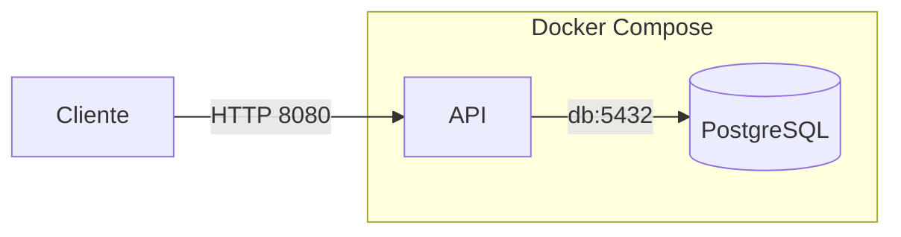

# Encurtador de URLs
 
API mínima de encurtamento de links em .NET 10, empacotada com Docker e validada por integração contínua no GitHub Actions.
 
É um projeto de estudo de infraestrutura. O foco não está nas funcionalidades da aplicação, que são propositalmente poucas, e sim em containerizar, subir o ambiente com um único comando, rodar em um servidor Linux e automatizar a verificação do código.
 
## O que a API faz
 
| Método | Rota | Descrição | Respostas |
| --- | --- | --- | --- |
| `POST` | `/links` | Recebe uma URL e devolve o código curto | `201` com `codigo` e `urlOriginal`, ou `400` se a URL for inválida |
| `GET` | `/{codigo}` | Redireciona para a URL original | `302` com o cabeçalho `Location`, ou `404` se o código não existir |
| `GET` | `/health` | Verifica se a API está de pé | `200` com `{"status":"ok"}` |
 
O corpo do `POST /links` é um JSON com o campo `url`:
 
```json
{ "url": "https://www.example.com" }
```
 
Só são aceitas URLs absolutas com esquema `http` ou `https`, com até 2048 caracteres.
 
## Arquitetura
 

 
A API e o banco rodam em containers na mesma rede criada pelo Docker Compose. A API encontra o banco pelo nome do serviço (`db`), e a porta do PostgreSQL não é publicada fora dessa rede.
 
## Tecnologias
 
- C# e ASP.NET Core (.NET 10), com Minimal API
- Entity Framework Core e PostgreSQL 17
- xUnit para os testes
- Docker (build multi-stage) e Docker Compose
- GitHub Actions para integração contínua
## Como rodar com Docker Compose
 
Pré-requisito: Docker com o plugin Compose.
 
```
git clone <url-do-repositorio>
cd <pasta-do-repositorio>/docker
cp .env.example .env
```
 
No PowerShell, troque o `cp` por `Copy-Item .env.example .env`.
 
Abra o arquivo `.env` e defina uma senha para o banco em `POSTGRES_PASSWORD`. Uma opção para gerar uma senha aleatória, em Linux ou macOS:
 
```
openssl rand -hex 16
```
 
Depois suba tudo:
 
```
docker compose up -d --build
```
 
Confira se a API respondeu:
 
```
curl -i http://localhost:8080/health
```
 
As tabelas do banco são criadas automaticamente na primeira inicialização da API.
 
### Exemplo de uso
 
Criar um link curto:
 
```
curl -i -X POST http://localhost:8080/links -H "Content-Type: application/json" -d '{"url":"https://www.example.com"}'
```
 
No PowerShell, as aspas duplas do JSON são alteradas antes de chegar ao `curl.exe`. Use o `Invoke-RestMethod`:
 
```
Invoke-RestMethod -Method Post -Uri http://localhost:8080/links -ContentType "application/json" -Body (@{ url = "https://www.example.com" } | ConvertTo-Json)
```
 
Acessar o link, trocando `CODIGO` pelo valor devolvido:
 
```
curl -i http://localhost:8080/CODIGO
```
 
### Parar o ambiente
 
```
docker compose down
```
 
Os dados do banco ficam guardados em um volume e sobrevivem a esse comando. Para apagar também os dados:
 
```
docker compose down -v
```
 
## Desenvolvimento local
 
Para rodar a API fora do Docker, são necessários o SDK do .NET 10, uma instância do PostgreSQL e a ferramenta `dotnet-ef`:
 
```
dotnet tool install --global dotnet-ef
```
 
A connection string fica nos user-secrets, fora do repositório:
 
```
dotnet user-secrets set "ConnectionStrings:Default" "Host=localhost;Port=5432;Database=encurtador;Username=encurtador;Password=<senha>" --project src/Encurtador
dotnet ef database update --project src/Encurtador
dotnet run --project src/Encurtador
```
 
Para rodar os testes:
 
```
dotnet test
```
 
## Decisões de projeto
 
- **Código curto aleatório em Base62:** são 7 caracteres sorteados com gerador criptográfico, o que dá mais de 3 trilhões de combinações e evita códigos previsíveis.
- **Unicidade garantida pelo banco:** a coluna do código tem índice único. Se o código sorteado já existir, o banco recusa a inserção e a API sorteia outro, com até 5 tentativas.
- **Validação da URL:** URLs com esquemas como `javascript:` ou `file:` são recusadas.
- **Imagem Docker multi-stage:** o SDK completo é usado só para compilar, e a imagem final contém apenas o runtime do ASP.NET.
- **Usuário sem privilégios no container:** a API roda como usuário comum, e não como root.
- **Healthcheck e ordem de inicialização:** a API só sobe depois que o PostgreSQL aceita conexões.
- **Configuração por variáveis de ambiente:** a connection string e a senha não ficam no código nem na imagem. O arquivo `.env` real não é versionado, apenas o `.env.example`.
- **Migrations na inicialização:** a API aplica as migrations ao iniciar quando a configuração `AplicarMigrations` está ligada, o que é o caso no Compose. É a opção mais simples para um projeto com uma única instância. Com várias réplicas, o mais indicado é rodar as migrations como uma etapa separada.
## Integração contínua
 
A cada push na branch `main` e a cada pull request, o workflow em `.github/workflows/ci.yml` executa dois jobs:
 
1. Restaura os pacotes, compila a solução e roda os testes.
2. Se o primeiro passar, constrói a imagem Docker, para garantir que o `Dockerfile` continua válido.
## Estrutura do repositório
 
```
.
├── .github/workflows/   workflow de CI
├── docker/              Dockerfile, docker-compose.yml e .env.example
├── src/Encurtador/      código da API
├── tests/Encurtador.Tests/   testes automatizados
└── Encurtador.slnx      solução
```
 
